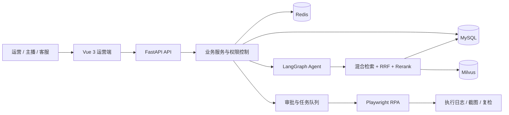

# 旅播智营：直播电商 RPA 智能运营 Agent

面向景区门票、酒店套餐等旅游直播业务的运营管理系统。项目把商品与直播场次管理、
开播前巡检、企业知识问答、风险审批和 RPA 自动化串成一条可追溯的业务流程。

[在线体验](https://tourism-live-agent-portfolio.onrender.com/#/intro) ·
[项目方案](docs/直播电商RPA智能运营Agent项目方案.md) ·
[演示指南](docs/demo/README.md) ·
[性能基准](docs/benchmark_2026-10-15.md)

> 演示账号：`demo_operator / Demo@123456`<br>
> 公开环境全部使用模拟数据，并开启只读保护。免费后端休眠后首次进入可能需要等待唤醒。

## 项目解决的问题

旅游直播团队同时面对商品价格、库存、活动、预约入园、节假日加价和退改政策等信息。
这些信息分散在业务后台和文档中，开播前依赖人工核对，改价、下架等操作也缺少统一审批和留痕。

```text
维护旅游产品 → 创建直播场次 → 执行开播巡检 → 解释风险
       → 人工审批 → RPA 执行与复检 → 场次复盘
```

RAG 和 Agent 用于查找、解释业务规则；确定性规则负责发现价格和库存问题；审批与 RPA 负责把处理结果安全地落到业务操作中。

## 核心功能

| 模块 | 主要能力 |
|---|---|
| 产品与直播场次 | 管理商品、SKU、库存、促销和本场选品，生成开播准备包 |
| 开播前巡检 | 检查商品状态、库存时效、活动有效期、计划价格和资料完整性，输出准备分与阻断项 |
| 企业知识库 | 解析 PDF、Word、Markdown、TXT，支持分块预览、重新向量化和处理状态跟踪 |
| RAG 问答 | 关键词与向量双路召回，RRF 融合后使用 BGE Reranker 精排，答案附引用来源 |
| LangGraph Agent | 在直接回答、混合检索、指定文档查询和文档清单之间路由，支持多轮检索与流式进度 |
| 权限与审计 | JWT、角色权限、知识库成员权限；权限撤销后重新检查历史回答的可见性 |
| 审批与 RPA | 改价、下架等高风险操作先审批，再由 Playwright 执行并保存步骤、截图和复检结果 |
| 监控与复盘 | 定时采集、异常聚合、任务状态监控，并按直播场次导出复盘记录 |

## 系统架构



后端按 `api → services → repositories → db` 分层。业务事务由 Service 层统一管理；
Milvus 只保存向量和定位字段，文档正文、权限关系与审计数据保存在 MySQL。

## 关键实现

### 混合检索与可追溯回答

- BGE-M3 向量召回补充语义匹配，jieba + MySQL 关键词召回保留型号、编号和专有名词。
- RRF 融合两路结果，再通过 BGE-Reranker-v2-M3 精排；重排服务异常时自动降级。
- 知识库权限在检索阶段过滤，答案引用可定位到文档、页码和原始分块。
- FAQ 命中时直接返回标准答案，不调用模型，减少延迟与费用。

### Agent 与会话

- LangGraph 管理状态、条件路由和最大检索轮数，限制模型调用成本。
- 支持普通 RAG SSE 逐字输出和 Agent 节点级进度输出。
- 会话历史、长期记忆和增量摘要均有独立开关与容量限制。

### 直播运营与 RPA

- 规则引擎负责确定性巡检，模型只解释风险并生成处理建议。
- 改价、下架等写操作采用人工审批，审批通过后才进入 Redis 任务队列。
- Worker 使用 Playwright 操作仿真电商后台，保存执行前后值、步骤日志、截图和结果核验。
- 未接入任何真实直播平台；外部平台层以可替换适配器和仿真后台展示集成能力。

## 技术栈

| 类型 | 技术 |
|---|---|
| 后端 | Python 3.12、FastAPI、SQLAlchemy 2、Pydantic 2、Alembic |
| 前端 | Vue 3、Vite、Element Plus、Pinia、Vue Router |
| 数据 | MySQL、Redis、Milvus |
| AI | LangGraph、LangChain、DeepSeek、BGE-M3、BGE-Reranker-v2-M3 |
| 自动化 | Playwright、Redis 任务队列、定时调度器 |
| 工程化 | JWT/RBAC、SSE、Docker、Pytest、Node Test |

## 本地运行

需要 Python 3.12、Node.js 20、MySQL、Redis 和 Milvus，以及兼容 OpenAI 协议的模型、Embedding API。

```bash
git clone https://github.com/Asi228/tourism-live-agent.git
cd tourism-live-agent
python -m venv .venv
```

Windows：

```powershell
.venv\Scripts\Activate.ps1
pip install -r requirements.txt
Copy-Item .env.example .env
```

Linux / macOS：

```bash
source .venv/bin/activate
pip install -r requirements.txt
cp .env.example .env
```

编辑 `.env`，填写 MySQL、Redis、Milvus、LLM 和 Embedding 配置。真实 `.env` 已被 Git 忽略。

启动后端：

```bash
alembic upgrade head
python -m uvicorn main:app --reload
```

启动前端：

```bash
cd frontend
npm ci
npm run dev
```

- 前端：`http://127.0.0.1:5173`
- 后端：`http://127.0.0.1:8000`
- Swagger：`http://127.0.0.1:8000/docs`

首次运行 RPA 前安装 Chromium：

```bash
playwright install chromium
python -m app.automation.worker
python -m app.automation.scheduler
```

也可以使用 `python scripts/start_stack.py` 完成迁移并启动主要开发进程。

## 演示数据

```bash
python scripts/seed_tourism_demo.py --reset
```

脚本会生成旅游产品、直播场次、巡检规则、知识库和演示账号。完整体验顺序见
[演示指南](docs/demo/README.md)。

## 测试与评测

```bash
# 后端单元测试，默认不访问真实外部服务
pytest -q

# 前端纯逻辑测试
cd frontend && npm test

# 直播运营 Agent 离线评测
python scripts/evaluate_live_agent.py
```

MySQL、Redis、Milvus 集成测试默认跳过，可通过对应的 `RUN_*_INTEGRATION=1` 环境变量单独开启。

2026-10-15 的串行基准中，24 次真实检索的 P50 为 96ms，Rerank P50 为 888ms；
该次报告未包含模型生成阶段，详细测试条件与限制见[性能基准](docs/benchmark_2026-10-15.md)。

## 公网演示

`render.yaml` 定义了三项资源：

- 免费静态介绍页：由 CDN 直接返回，并在浏览项目介绍时后台唤醒服务。
- Web Service：运行 Vue 构建产物和 FastAPI，使用 SQLite 与文件向量库承载固定演示数据。
- Render Key Value：为限流和任务状态提供 Redis 兼容服务。

公网环境开启 `DEMO_READ_ONLY`，访客可以查询和体验流程，不能修改商品、场次、审批或知识库。
本地与企业部署仍使用 MySQL、Redis、Milvus 和 Alembic 迁移。

## 项目结构

```text
app/
├─ api/             # HTTP 接口与鉴权依赖
├─ services/        # 业务编排与事务边界
├─ repositories/    # 数据访问
├─ agent/           # LangGraph 工作流
├─ rag/             # 解析、检索、融合、重排与生成
├─ automation/      # RPA 页面适配与调度
└─ models/          # SQLAlchemy 模型

frontend/           # Vue 3 运营端
migrations/         # Alembic 迁移
scripts/            # 启动、播种、评测、巡检和恢复工具
docs/               # 方案、演示资料、评测与性能报告
tests/              # 后端测试
```

## 更多文档

- [项目业务方案](docs/直播电商RPA智能运营Agent项目方案.md)
- [旅游直播演示指南](docs/demo/README.md)
- [检索性能基准](docs/benchmark_2026-10-15.md)
- [追问改写对照实验](docs/benchmarks/query-rewrite.md)
- [Agent 离线与真实模型评测](docs/evaluations/)

## 已知边界

- 当前使用仿真电商后台演示 RPA，没有对接真实直播平台账号或内部接口。
- 扫描件 PDF 暂不支持 OCR，只解析带文本层的文件。
- 公网免费实例会休眠，静态介绍页不受影响，进入完整系统时可能需要等待唤醒。
- 公开演示的 SQLite 数据会随实例重建恢复为固定种子数据，不用于持久化真实业务。

## License

[MIT](LICENSE)。项目中的公司、商品、账号和业务资料均为模拟数据。
